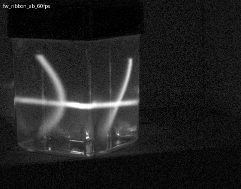
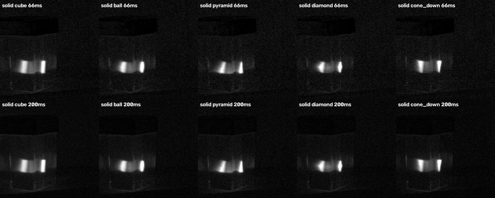
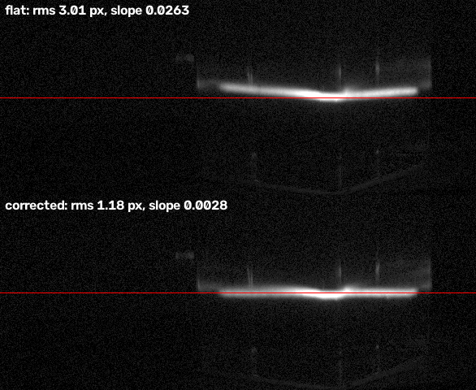

# Bot Holography Exploration

These experiments put light shapes inside a small liquid-filled case with a **stock TI DLP LightCrafter 4500**. The projector shines blue light through HDMI into an acrylic case of glycerin with fluorescein dye, and every lit mirror becomes a glowing ray through the liquid. The case stands corner-on, so rays enter through two faces. The two families of rays cross inside the liquid to form planes, ribbons and solid shapes.

> **Honest status.** This is *volumetric projection in a fluorescent medium*, not holography.
> - No holographic reconstruction has been made in hardware. The holography work in `holo/` is design and simulation only.
> - A camera photo of a projected pattern is an intensity image, never a holographic reconstruction.
> - Claims carry tags: **[PROVED]** (measured here, or arithmetic or simulation stated as such), **[ASSERTED]** (standard physics or vendor data) and **[HEURISTIC]** (judgement, a visual read, or a placeholder model).

| `fw_ribbon`: plane + ribbon curtains (stop-motion, camera) | Solid shapes from two faces | Plane before / after warp correction |
|---|---|---|
|  |  |  |

## What works so far

- **Two ray families** cross at about 29–30° in glycerin [model]. The collimated limit is 32.5° [PROVED, Snell]. The crossing angle has never been measured directly.
- **Scenes:** ribbons, thick planes, ocean waves, solid shapes and "string-art" layer stacks. By Joey's eye, ribbons had the best structure and animation [HEURISTIC, visual]. One camera cannot show 3D form, so the camera images are 2D views.
- **The 60 Hz player** (`vol2/volplay.py`) held 59.9–60.0 frames/s with 0–4 late frames in each of the 21 logged scenes. This counts software pushes only; what the DMD displayed was not measured [PROVED for the software loop].
- **Measured duty curve:** blue level → glow has a dead zone up to about 48, then follows ≈ (v/255)^2.6 [PROVED, camera].
- **Warp correction:** a dot-grid scan maps how the case bends the projection. A per-column correction straightened a flat plane as seen from the camera: slope 0.026 → 0.003, RMS 3.0 → 1.2 px, over DMD columns 610–750. The correction only holds for that camera position [PROVED, camera].
- **Hard limits of a linear glowing medium:**
  - A crossing is at most 2× as bright as one ray.
  - n points at one height give n² crossings (ghosts), and a horizontal line lights a whole plane.
  - Fast time-multiplexing doesn't remove ghosts.
  - True floating voxels need a moving screen or a two-step (nonlinear) medium.

The full story with every number and caveat is in [docs/BRIEFING.md](docs/BRIEFING.md). The running log is [docs/LAB_LOG.md](docs/LAB_LOG.md).

## Quick start (offline, any OS)

```bash
python -m pip install -e ".[dev]"                 # use [dev] OR [bench] per environment, not both
python -m pytest                                   # a few minutes; never touches hardware
python -m vol2.volplay ribbon --dry --seconds 2    # render a scene; frames go to vol2/out/volplay/
```

Offline work needs no bench: the ray model, the scene renders, the simulations and the OGR math checks. The player and the warp-corrected scenes use the calibration bundled in `data/calibration/`, unless a newer complete bench run exists in `runs/`.

## On the bench (Windows, Joey's rig)

Read **[SAFETY.md](SAFETY.md)** first.

1. Set up the hardware:
   - The DMD is an extended display: 912 × 1140, 100 % scaling, at desktop position (1920, 0), with a plain black desktop background. The window refuses to open if it does not land exactly there.
   - The camera needs PySpin from the FLIR Spinnaker SDK.
2. Install: `pip install -e ".[bench]"` (GUI OpenCV and pytest; do not also install `[dev]`, whose headless OpenCV conflicts).
3. Play a scene: `python -m vol2.volplay ribbon --seconds 30`.
   - It takes the shared rig lock, plays at 60 Hz, blanks the DMD, closes its window and releases the lock.
   - To stop early, create a `STOP` file in the repo root (`New-Item STOP` in PowerShell). See SAFETY.md, Stopping.

| Variable | Default | Meaning |
|---|---|---|
| `DLP_MONITOR_OFFSET` | `1920,0` | Desktop position of the DMD display |
| `DLP_EXPOSURE_US` | `16667` | Camera exposure (a whole number of 60 Hz frames) |
| `DLP_RUNS` | `runs/` | Where captures go (git-ignored) |
| `DLP_NO_HARDWARE` | unset | `1` forbids opening the DMD window or camera (tests, CI, cloud sessions) |

The rig lock is always the swiss-army-scanner's `%PROGRAMDATA%\swiss_army_scanner\rig.lock`, so the two programs exclude each other. It is deliberately not configurable.

Calibration, sub-frame packing and the other commands are in [docs/BRIEFING.md §5](docs/BRIEFING.md#5-how-to-run).

## Layout

| Path | What |
|---|---|
| `rig/` | **The only hardware layer:** rig lock, HDMI window, camera, `Bench`, and the safety guards |
| `vol2/` | Two-face ray model (Snell, TIR, walk-off), rendering, simulation, scenes, the 60 Hz player, calibration, the 1440 Hz sub-frame and flash-pack writers |
| `holo/` | Holography design and simulation (Fresnel cube, LED coherence study); no hardware holography. `holo_show.py` holds a frame on the bench through `rig/` |
| `tools/` | Bench helpers: numbered grid, frame hold loop, capture sets, GIF makers, a demo playlist |
| `configs/` | Bench records, case maps (from projected-grid call-outs) and fitted case geometry |
| `data/calibration/` | The bundled duty curve and warp map (bench, 2026-10-05) |
| `data/results/` | Measured results and simulation reports |
| `docs/` | Briefing, lab log, first-day results, figures |
| `third_party/OGR_DMD_MathPackage_v1.0/` | Joey's OGR DMD math package and its Lean files (`ogr.validate`: 31/31); see Licence |
| `tests/` | Offline tests: model, scenes, OGR, and the machine-safety rules |

## Working on this with Claude

[CLAUDE.md](CLAUDE.md) holds the rules for AI coding sessions:
- offline only, and never the hardware;
- don't weaken `rig/`;
- tag claims and don't overclaim.

[BACKLOG.md](BACKLOG.md) lists the open work. It is split into offline items, which a cloud session can take, and bench items, which Joey runs.

## Licence

Apache-2.0 (see [LICENSE](LICENSE)), except `third_party/OGR_DMD_MathPackage_v1.0/`, which keeps its own terms: its README says MIT / CC-BY, and the `corpus/` files carry CC-BY 4.0 headers. Its `_bessel_j1` was replaced here by an independent implementation of Bessel's integral (see that package's `ogr/hardware.py`). Hardware references: TI DLPU011E (DLP LightCrafter 4500 user's guide). Bit-plane volumetric display: J. Geng, *Displays* 34 (2013) 39–48.
